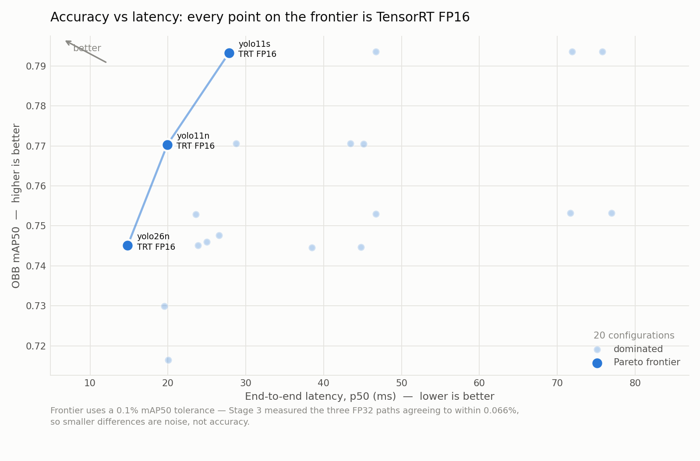
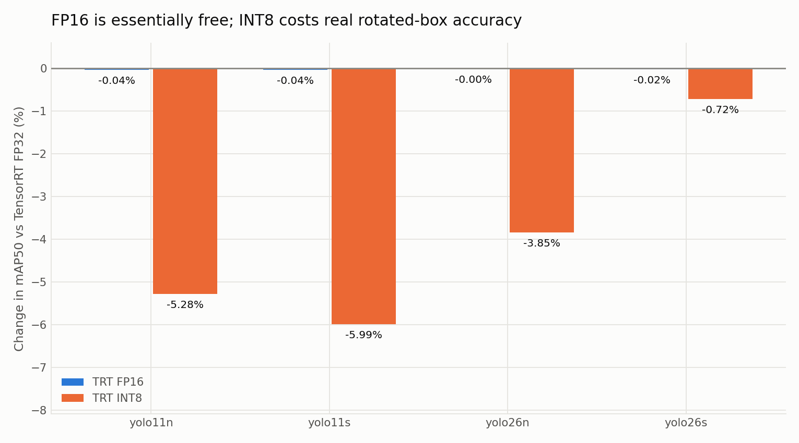
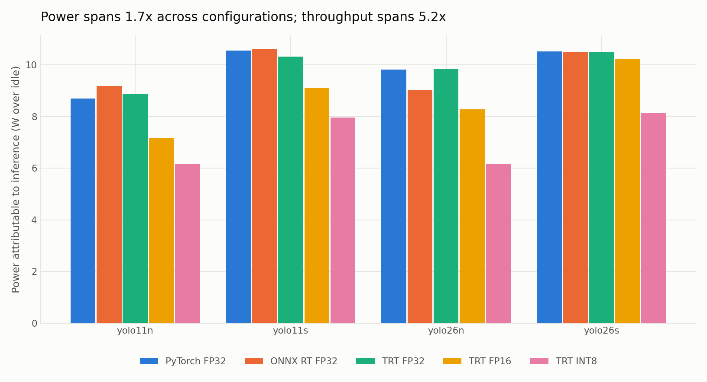

# YOLO OBB → TensorRT Benchmark Suite (Jetson Orin NX)

How Ultralytics' **DOTAv1-pretrained oriented-bounding-box (OBB)** models behave
across five deployment formats on a Jetson Orin NX — measured, not estimated.
**20 configurations**: 4 models × (PyTorch FP32, ONNX Runtime CUDA FP32,
TensorRT FP32 / FP16 / INT8), at `imgsz=1024`, batch 1, on the full DOTAv1
validation tile set.

> **Independent personal project.** Not affiliated with, and uses no data or
> code from, any funded/sponsored research project I've worked on. All models
> and datasets used here are public.

Every number below is read from `results/*.csv` by `scripts/build_readme.py`.
None of it is typed by hand.

## Headline results

**Fastest:** `yolo26n-obb` TensorRT FP16 — **67.5 FPS**
(14.82 ms end-to-end) at mAP50 0.74509.
**Most accurate:** `yolo11s-obb` PyTorch FP32 — mAP50 0.79364.
**Most energy-efficient:** `yolo11n-obb` TensorRT INT8 —
0.120 J/frame.



Every configuration on the speed/accuracy frontier is **TensorRT FP16**.

## Full results

mAP50 / mAP50-95 are OBB metrics over 5,278 val tiles. Latency is p50 over
300 timed iterations after 20 warmup. Power is watts attributable to inference
(measured draw minus an idle baseline). J/frame = power over idle ÷ FPS.

| Model | Format | mAP50 | mAP50-95 | infer ms | total ms | FPS | size MB | W over idle | J/frame |
|---|---|---|---|---|---|---|---|---|---|
| yolo11n-obb | PyTorch FP32 | 0.77057 | 0.60270 | 32.09 | 43.44 | 23.0 | 5.5 | 8.70 | 0.378 |
| yolo11n-obb | ONNX RT FP32 | 0.77054 | 0.60268 | 35.69 | 45.13 | 22.2 | 10.5 | 9.18 | 0.414 |
| yolo11n-obb | TensorRT FP32 | 0.77058 | 0.60285 | 19.36 | 28.75 | 34.8 | 12.3 | 8.88 | 0.255 |
| yolo11n-obb | TensorRT FP16 | 0.77031 | 0.60290 | 10.52 | 19.92 | 50.2 | 8.4 | 7.17 | 0.143 |
| yolo11n-obb | TensorRT INT8 | 0.72987 | 0.56538 | 10.14 | 19.50 | 51.3 | 5.3 | 6.18 | 0.120 |
| yolo11s-obb | PyTorch FP32 | 0.79364 | 0.63259 | 63.18 | 71.89 | 13.9 | 19.0 | 10.55 | 0.759 |
| yolo11s-obb | ONNX RT FP32 | 0.79358 | 0.63246 | 66.47 | 75.79 | 13.2 | 37.4 | 10.60 | 0.804 |
| yolo11s-obb | TensorRT FP32 | 0.79359 | 0.63253 | 38.00 | 46.69 | 21.4 | 39.3 | 10.33 | 0.482 |
| yolo11s-obb | TensorRT FP16 | 0.79330 | 0.63266 | 18.58 | 27.85 | 35.9 | 22.2 | 9.10 | 0.254 |
| yolo11s-obb | TensorRT INT8 | 0.74602 | 0.57760 | 15.58 | 24.98 | 40.0 | 13.8 | 7.95 | 0.199 |
| yolo26n-obb | PyTorch FP32 | 0.74462 | 0.58932 | 34.04 | 38.47 | 26.0 | 5.6 | 9.81 | 0.378 |
| yolo26n-obb | ONNX RT FP32 | 0.74465 | 0.58938 | 35.30 | 44.78 | 22.3 | 9.7 | 9.02 | 0.404 |
| yolo26n-obb | TensorRT FP32 | 0.74511 | 0.58948 | 19.33 | 23.86 | 41.9 | 11.8 | 9.86 | 0.235 |
| yolo26n-obb | TensorRT FP16 | 0.74509 | 0.58910 | 10.29 | 14.82 | 67.5 | 8.6 | 8.27 | 0.123 |
| yolo26n-obb | TensorRT INT8 | 0.71646 | 0.55219 | 10.61 | 20.05 | 49.9 | 5.4 | 6.16 | 0.124 |
| yolo26s-obb | PyTorch FP32 | 0.75327 | 0.60523 | 67.23 | 71.67 | 13.9 | 20.7 | 10.52 | 0.754 |
| yolo26s-obb | ONNX RT FP32 | 0.75321 | 0.60521 | 67.55 | 76.95 | 13.0 | 37.6 | 10.48 | 0.807 |
| yolo26s-obb | TensorRT FP32 | 0.75305 | 0.60518 | 42.12 | 46.71 | 21.4 | 39.5 | 10.50 | 0.490 |
| yolo26s-obb | TensorRT FP16 | 0.75289 | 0.60463 | 19.00 | 23.55 | 42.5 | 22.4 | 10.24 | 0.241 |
| yolo26s-obb | TensorRT INT8 | 0.74766 | 0.58346 | 17.13 | 26.54 | 37.7 | 15.5 | 8.14 | 0.216 |

### TensorRT speedup over the baselines

Like-for-like at FP32 (left two columns), and the best-case FP16 engine against
the same FP32 baselines (right two):

| Model | FP32: vs PyTorch | FP32: vs ONNX RT | FP16: vs PyTorch | FP16: vs ONNX RT |
|---|---|---|---|---|
| yolo11n-obb | 1.51x | 1.57x | 2.18x | 2.27x |
| yolo11s-obb | 1.54x | 1.62x | 2.58x | 2.72x |
| yolo26n-obb | 1.61x | 1.88x | 2.60x | 3.02x |
| yolo26s-obb | 1.53x | 1.65x | 3.04x | 3.27x |

### What each precision step costs and buys

Accuracy change and speedup, both measured against **TensorRT FP32** so the
engine build path is held constant:

| Model | FP16 mAP50 | FP16 speedup | INT8 mAP50 | INT8 speedup |
|---|---|---|---|---|
| yolo11n-obb | -0.04% | 1.44x | -5.28% | 1.47x |
| yolo11s-obb | -0.04% | 1.68x | -5.99% | 1.87x |
| yolo26n-obb | -0.00% | 1.61x | -3.85% | 1.19x |
| yolo26s-obb | -0.02% | 1.98x | -0.72% | 1.76x |





## What I found

**TensorRT FP16 is the operating point to pick.** It is on the speed/accuracy
frontier for every model, costs at most 0.04%
of mAP50 against FP32, and runs 1.44–1.98x
faster than FP32 while drawing *less* power. There is no trade to agonise over:
it is close to free.

**INT8 does hurt rotated boxes, and it was worth checking rather than assuming.**
It costs 0.72%–5.99%
of mAP50 — one to two orders of magnitude more than FP16 — and for every model
the **mAP50-95 drop is larger than the mAP50 drop**. That signature matters: it
means boxes are still being *found* but fit less precisely. For oriented boxes
the angle is part of that fit, which is exactly the failure mode you would worry
about when quantizing an OBB model, and it shows up in the data.

Worse, INT8 barely pays for itself here. On this board it is at most
1.87x faster than FP32, and for both yolo26 models it is
*slower end-to-end than FP16*. Its one genuine win is energy: the lowest
power draw and the best J/frame of any configuration measured.

**The newer model generation does not win on this dataset.** yolo26 scores below
yolo11 at both sizes (-2.6 points nano,
-4.0 points small, PyTorch FP32). It wins on *speed*,
because its NMS-free head makes postprocess roughly 6x cheaper — which is how
`yolo26n-obb` TRT FP16 ends up the fastest configuration overall despite being
less accurate than `yolo11n-obb`.

**ONNX Runtime is not a speedup — it is slower than PyTorch** by
3.9%–16.4% on every model. It earns its place as a
control: it shows the gain comes from TensorRT specifically, not merely from
leaving Python.

### What surprised me

1. **INT8 being slower than FP16** for the yolo26 models. Chasing it down showed
   the ONNX and INT8 exports *silently lose yolo26's NMS-free head* — they emit
   raw predictions `(1, 20, 21504)` instead of `(1, 300, 7)` and pay full rotated
   NMS. The regression is in postprocess, not the engine.
2. **Host-side work is the floor.** Preprocess is ~3.6 ms and yolo11's NMS
   postprocess ~5.8 ms regardless of format. At FP16 the GPU finishes so quickly
   that these dominate — GPU utilisation *falls* from 77% (PyTorch) to 59%
   (INT8). Optimising the engine further would buy little.
3. **Power barely moves while throughput moves a lot.** All 20 configurations sit
   within 6.2–10.6 W over idle, but throughput spans
   13.0–67.5 FPS. Energy per frame is therefore driven by speed,
   not by instantaneous draw.
4. **No thermal throttling at all** in 20 × 60 s sustained runs — peak
   77.3 °C against a 95 °C trip, GPU frequency pinned at 765 MHz
   throughout.

## Methods

**Data.** DOTAv1 (official Ultralytics release, 1.85 GiB), tiled with
Ultralytics' documented `split_dota` at crop 1024 / gap 200 / `rates=(1.0,)`,
background tiles kept. Train → 15,749 tiles,
val → 5,297 tiles. The DOTAv1 **test** split has no public labels and is
never used.

**Evaluated tile count.** 5,278 of 5,297 val tiles. Ultralytics' label
scan rejects 19 tiles (0.36%) whose coordinates land fractionally above 1.0 — an
artefact of its own edge-crop normalisation. The exclusion is identical for all
20 configurations, so comparisons are unaffected. Stated rather than rounded
up to "the full set".

**INT8 calibration.** 1,000 tiles sampled with seed 0 from the **train** tiles,
disjoint from evaluation at both tile and source-image level (0 overlap across
606 source images). This matters: the Ultralytics exporter defaults to
`data[args.split or "val"]`, so an unguarded INT8 export calibrates on the very
images it is scored on. `configs/dota_calib.yaml` points its `val` key at the
train sample to prevent that. 999 tiles were usable (one hit the same
edge-coordinate quirk). Note TensorRT keeps 85 Sigmoid layers in FP32, so this
is Ultralytics' mixed-precision INT8, not uniform 8-bit.

**One engine build path.** Every engine comes from
`model.export(format="engine", imgsz=1024, batch=1, quantize=32|16|8)`, and the
*same* `.engine` file is used for accuracy, latency and power. No second
ONNX→TRT path.

**Timing.** Identical protocol for all five formats: every row goes through
`model.predict()` and reports Ultralytics' own preprocess/inference/postprocess
split. Tiles are pre-loaded into memory, so disk I/O is never timed. 20 warmup +
300 timed iterations on a fixed seeded set of 50 val tiles. Measurement
stability: median p50→p95 spread 1.71%, max 5.16%. The p50→p99 figure is wider,
but the absolute p99−p50 gap is a near-constant ~5.85 ms across all
configurations — a fixed host-side stall (~3 iterations in 300), not
proportional instability.

**ONNX Runtime really is CUDA.** `onnxruntime-gpu` also exposes
`TensorrtExecutionProvider`, so an unguarded ONNX baseline can silently become a
second TensorRT measurement. Every ONNX row records
`provider=CUDAExecutionProvider`, corroborated by the run logs.

**Power.** `tegrastats` sampled at 200 ms **in a background thread during**
sustained inference (the original script sampled after the loop and measured an
idle GPU). GPU utilisation is recorded per row — 58.8–92.4% — so
"measured under load" is verifiable rather than asserted. An idle baseline
(8.40 W) is subtracted. Throttle detection uses the board's real
trip points from `/sys/class/thermal` plus GPU `cur_freq`, which is pinned at
765 MHz so any drop is direct evidence.

**Environment.** Jetson Orin NX 8GB module, JetPack 6.2 (L4T R36.5.0),
CUDA 12.6, TensorRT 10.3.0, ultralytics 8.4.104, onnxruntime-gpu 1.23.0,
torch 2.11.0, Python 3.10.12. Full detail and the GPU verification evidence:
[results/environment.md](results/environment.md).

## Limitations

- **One board, one software stack.** Orin NX 8GB, TensorRT 10.3.0. INT8 kernel
  selection is hardware- and version-specific; these numbers will not transfer
  unchanged to an AGX, a Nano, or a different JetPack.
- **`jetson_clocks` was not applied** (needs root), so the CPU governor was
  `schedutil`. The GPU was observed pinned at its 765 MHz ceiling, and p50
  figures are stable to 1.71% at p95, but the rare ~6 ms host-side stalls are
  the most likely thing a fixed-clock run would improve.
- **Single-image latency, batch 1.** No batching, no multi-stream, no
  DeepStream. Throughput under concurrency is a different question.
- **One dataset.** DOTAv1 only. Aerial imagery with many small objects per tile
  is a specific workload; the INT8 accuracy cost in particular may not
  generalise.
- **One calibration set.** 1,000 tiles, seed 0, not ablated. Calibration size
  and composition are known to affect INT8 quality.
- **Thermals are a 60 s result, not a soak test.** No throttling was observed,
  but temperatures were still climbing across the run sequence. "No throttling
  in 60 s" is not "no throttling in a 25-minute flight".
- **An unrelated process** (~1.4 GB resident) was running on the board
  throughout and contributes to the idle baseline and to host-side scheduling
  noise.
- **yolo26 ONNX / INT8 rows are not architecturally like-for-like** with their
  siblings, because those exports lose the NMS-free head (see *What surprised
  me*). Their accuracy is unaffected; their latency reflects the decode path as
  much as the precision.

## Reproduce

From a fresh clone on a Jetson (JetPack 6.x). Execution is Jetson-only —
`tensorrt` and `pycuda` need the board.

```bash
# 1. Environment. Do NOT use a bare `pip install -r requirements.txt` on a
#    Jetson — see the header of requirements.txt for why.
bash scripts/setup_venv.sh
source .venv/bin/activate

# 2. Data: download DOTAv1 (~1.85 GiB), tile it, build the calibration set.
#    Also (re)generates configs/dota_obb.yaml and configs/dota_calib.yaml with
#    absolute paths for THIS checkout — they bypass Ultralytics' machine-wide
#    datasets_dir, so they must be regenerated rather than used as committed.
#    Writes results/dota_stage1.json with tile counts and the calibration seed.
python scripts/prepare_dota.py --data-root data/DOTAv1 --tiles-dir data/DOTAv1-tiles \
    --calib-dir data/DOTAv1-calib --calib-n 1000 --seed 0

# 3. Export: 4 ONNX + 8 FP32/FP16 engines (~40 min), then 4 INT8 engines (~55 min)
python scripts/export_models.py --config configs/models_obb.yaml --precisions fp32,fp16
python scripts/export_models.py --config configs/models_obb.yaml --precisions int8 --skip-onnx

# 4. Verify every artifact loads and runs
python scripts/verify_artifacts.py --config configs/models_obb.yaml

# 5. Accuracy: all 20 configurations on the full val tile set (~90 min)
python scripts/evaluate_obb.py --config configs/models_obb.yaml

# 6. Latency + memory (~20 min)
python scripts/benchmark_obb.py --config configs/models_obb.yaml

# 7. Power + thermals, 60 s sustained per configuration (~30 min)
python scripts/power_profile_obb.py --config configs/models_obb.yaml --duration 60

# 8. Charts and this README
python scripts/plot_obb_results.py
python scripts/build_readme.py
```

Step 2 regenerates the two dataset yamls for your checkout — the committed
copies carry the original machine's absolute paths and will not resolve
elsewhere.

Long stages append a CSV row as each configuration finishes and skip rows
already marked `ok`, so an interrupted run resumes without recomputing.
Run them under `tmux` or `nohup`.

`ROADMAP.md` tracks scope and staging; `CLAUDE.md` documents how to work in the
repo. Per-stage write-ups, including the things that went wrong, are in
`results/stage*_notes.md`.

## How AI assistance was used

This project was built with Claude Code (Anthropic) as a pair-programming tool,
under my direction and review. Concretely, the assistant:

- wrote and refactored the pipeline scripts in `scripts/` and `src/`;
- ported `src/trt_infer.py` and `scripts/build_engine.py` from the TensorRT
  binding API (removed in TensorRT 10) to the tensor-name API;
- diagnosed failures during the runs — including an allocator crash that was
  really an out-of-memory in rotated NMS, a CSV column misalignment, and three
  defects in the original `power_profile.py` (sampling after the inference loop,
  an uppercase `GPU@` regex that matched nothing on this JetPack, and an
  invented throttle threshold);
- drafted this README and the per-stage notes in `results/`.

What it did **not** do: produce any number reported here. Every figure in this
README is computed by `scripts/build_readme.py` from CSVs written by scripts
that actually ran on the Jetson. I reviewed each stage before it was committed,
and `ROADMAP.md` records the staging that work followed.

## License

MIT — see [LICENSE](LICENSE).
